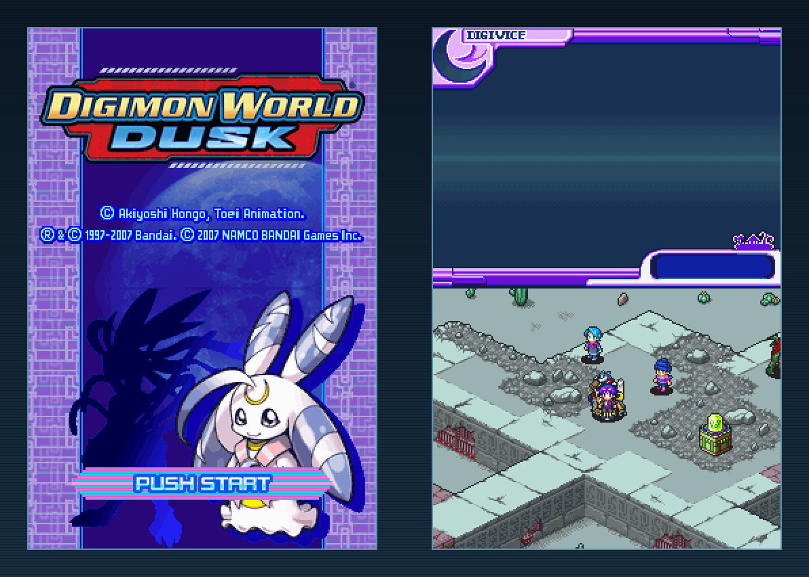
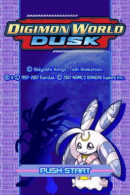
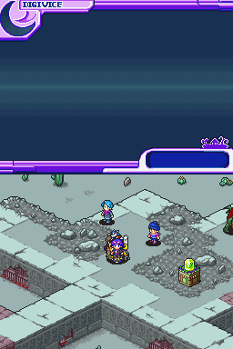

# Digimon World: Dusk — native Windows recompilation

A static recompilation of **Digimon World: Dusk (USA)** for 64-bit
Windows. The DS ARM9 and ARM7 programs are translated to C at build time and
compiled into a native executable: this is **not an emulator**, and it ships
with no game data.

You bring your own cartridge dump. The first launch checks it, builds the
runtime on your machine, and starts the game.

[English](README.md) · [简体中文](README.zh-CN.md) · [Building](docs/BUILDING.md) ·
[How it works](docs/HOW_IT_WORKS.md) · [Mods](dusk-recomp/docs/MODS.md)



> **Unofficial fan project.** Not affiliated with or endorsed by Bandai Namco,
> Nintendo, or the Digimon rights holders. No ROM, BIOS dump, firmware image,
> save file, or recompiled game code is distributed here. Digimon and its
> assets belong to their respective owners.

---

## Play on Windows

1. Download `dusk-<version>-windows-x64-sources.zip` from
   [Releases](https://github.com/aoxzh/digimon-world-dusk-recomp/releases) and unzip it somewhere writable — for example
   `Documents\Dusk`, **not** `Program Files`.
2. Put your own dump at
   `rom\Digimon World - Dusk (USA).nds`.
3. Run **`play.bat`**.

The first run downloads a pinned private toolchain (LLVM-MinGW, CMake, Ninja,
SDL3, ndspy), verifies it, compiles the recompiler and the runtime, then starts
the game. Expect **2–5 minutes** on a modern machine and roughly 1 GB of disk
for the toolchain. Later launches start immediately.

This repository and its release publish the sources shape only — there is no
prebuilt executable. The runner is compiled on your machine, so the download
stays small and no translated game code is redistributed.

### What you need

| Requirement | Notes |
|---|---|
| Windows 10/11 x64 | The build kit targets llvm-mingw; no Visual Studio needed |
| Your own ROM | USA, revision 0, 64 MiB, exact dump listed below |
| ~1 GB free disk | Toolchain plus build output |
| Internet on first run | Only for the toolchain; the game itself never phones home |
| No BIOS dump | The port builds FreeBIOS banks; retail BIOS is optional |

### ROM

| | |
|---|---|
| Title | Digimon World: Dusk (USA) |
| Game code | `A6RE` |
| Size | 67,108,864 bytes (64 MiB) |
| SHA-1 | `de1a1915e07288ffad654f3f9f2eb730a0fd1d9c` |
| SHA-256 | `df9522e07be99c5622e0211d3a50132776784db3fb28f42fc7392f588e1ae8cb` |

Other regions and revisions are not supported: the ROM hash is compiled into
the executable and a different image is refused at startup. A translation patch
is only supported through the build-time mod pipeline, never by renaming a
patched file to look like the retail dump.

---

## Screenshots

| Title | First map, free control |
|---|---|
|  |  |

Both are 256×384 captures from the port itself, straight from the DS
framebuffers, not from an emulator.

---

## Controls

| DS | Keyboard |
|---|---|
| D-pad | Arrow keys |
| A | `X` |
| B | `Z` |
| X | `S` |
| Y | `A` |
| L / R | `C` / `V` |
| Start | `Enter` |
| Select | `Right Shift` |
| Touch screen | Mouse (left click) |

| Feature | Key |
|---|---|
| Settings menu | `Esc` (arrows navigate, `Enter` selects, `Backspace` goes back) |
| Fast forward (held) | `Left Shift` |
| Save state slot 1–12 | `F1`–`F12` |
| Save state (write) | `Shift` + `F1`–`F12` |
| Save state (load) | `F1`–`F12` |

Gamepads are detected automatically. Settings live in `settings.ini`; saves in
`saves\`, save states in `savestates\`, logs in `logs\`.

---

## What works

Checked on Windows 11 x64 with a build from this repository (FreeBIOS, no BIOS
dumps, base banks, no promoted coverage):

| Area | Status |
|---|---|
| Boot → publisher splash → title | Verified (title smoke: every frame lit, no dispatch miss) |
| NEW GAME: gender, name entry, pack select, pack confirm, three starter nicknames | Verified |
| Opening story scenes and the tutorial 3D battle | Verified (A advances; reached free control at about vblank 30,750) |
| First map: walking, the game's own menu, Digimon status screen, backing out | Verified |
| Sources release: clean unzip → first-start build → title screen | Verified (offline, with an existing toolchain; the kit download was not exercised) |
| Battery save, save states, settings menu, filters, fast forward | Shared with the sister port, **not yet re-checked on Dusk** |
| Later chapters and the full game | **Not verified** |
| Wi-Fi / local wireless, microphone, IR | Not implemented |

The tested route is the start of a new game up to the first free-control map,
about 36,000 frames. Treat everything past that as unproven rather than
working. Please [report problems](https://github.com/aoxzh/digimon-world-dusk-recomp/issues).

Save files are raw 64 KiB EEPROM images. Compatibility with saves written by
other emulators has not been verified on this build; keep a backup.

---

## Performance

Not measured on this build yet. The sister port on the same engine and runtime
runs its tested route at roughly 2× real time.

---

## Sister port: Digimon Story: Sunburst

*Digimon World: Dusk* is the North American release of the engine behind
*Digimon Story: Sunburst / Moonlight*. The ARM7 program is byte-identical and the
ARM9 is nearly so, so this port shares its framework, build driver, release kit
and fixes with
[digimon-story-sunburst-recomp](https://github.com/aoxzh/digimon-story-sunburst-recomp).
The two repositories differ only in title identity, configuration and
documentation; a fix found on one is carried to the other.

---

## How it works

1. `prepare` verifies the ROM and extracts the ARM9 image, the ARM7 image and
   every overlay into a build directory.
2. The recompiler walks the ARM9/ARM7 entry points and emits C for each
   function, with a validation record (address, length, source bytes) beside it.
3. The banks are compiled and linked with the runtime: memory map, 2D engines,
   melonDS-derived 3D rasteriser, audio mixer, DMA, timers, IPC, EEPROM and an
   SDL3 front end.
4. Before a translated function runs, the runtime checks that the guest bytes
   still match the bytes it was compiled from. If a region was overwritten at
   run time (self-modifying code, a loader-produced block), it falls back to the
   bounded Tier-3 interpreter instead of executing a stale translation.

There is no HLE shortcut for game behaviour: the game's own code runs, either
native or interpreted. Details and the build pipeline are in
[docs/HOW_IT_WORKS.md](docs/HOW_IT_WORKS.md).

---

## Building

The short version, from a checkout with a working C toolchain:

```bat
cd dusk-recomp
python -m pip install ndspy
python tools\dusk.py prepare
python tools\dusk.py recompiler
python tools\dusk.py banks
python tools\dusk.py build
```

The runner lands in `dusk-recomp\generated\windows\runner\`. For the
first-start kit (no compiler installed), use the release zip and `play.bat`.
Full prerequisites, toolchain discovery and troubleshooting are in
[docs/BUILDING.md](docs/BUILDING.md).

---

## FAQ

**Is this an emulator?** No. The ARM9/ARM7 code is translated to C at build
time and compiled to x64. There is no instruction-by-instruction emulation of
the game's code, and no cartridge bus timing to get wrong.

**Do I need BIOS dumps?** No. The port builds FreeBIOS banks and generated
firmware. Retail BIOS dumps are optional and only used by the `--boot lle`
development mode.

**Can I share the built `nds_runner.exe`?** The executable links GPL-3.0-or-later
components from the vendored framework, so it is a GPL combined work. Share it
under those terms, and never with the ROM, BIOS, firmware, saves or generated
game code bundled in.

**Why is the executable so large?** It contains compiled game code plus the
runtime and its assets. A debug build of the promoted bank can be a few hundred
megabytes; the release build from the zip is much smaller because it compiles
only the base banks.

**Why does the first start download a compiler?** Shipping a compiler and SDK
would multiply the download and drag in licences that do not belong in a fan
project. The kit is fetched once, SHA-256 verified, and reused.

**It says my ROM is wrong.** Check the SHA-1 above. A patched, trimmed, or
different-region image is refused by design.

**Where are my saves?** `saves\dusk.sav` beside `play.bat`; save states in
`savestates\slot-01.state` … `slot-12.state`.

**Does it work on Linux or macOS?** Not yet. The tools are portable and the
framework builds on other hosts, but this release ships a Windows build kit only.

**Can I use a translation patch?** Yes, through the build-time mod pipeline:
drop an IPS/IPS32/BPS patch into `dusk-recomp\mods\translation\` and build
from source. See [docs/MODS.md](dusk-recomp/docs/MODS.md).

---

## License

The original tooling, build scripts, configuration and documentation in this
repository are MIT licensed; see [LICENSE](LICENSE). The game is not covered and
is not distributed. The vendored framework keeps its own licences: ndsrecomp is
PolyForm Noncommercial 1.0.0 with MIT and GPL-3.0-or-later portions, recomp-ui is
MIT, FreeBIOS is BSD-2-Clause, and the melonDS-derived GPU code is
GPL-3.0-or-later. See [THIRD_PARTY_NOTICES.md](THIRD_PARTY_NOTICES.md) and the
licence files under `framework/`.

## Credits

- [ndsrecomp](https://github.com/mstan/ndsrecomp) and
  [recomp-ui](https://github.com/mstan/recomp-ui) by Matthew Stanley — the
  static recompiler, runtime and UI framework.
- [melonDS](https://melonds.kuribo64.net/) — GPL-3.0 3D rasteriser lineage.
- [FreeBIOS](https://github.com/pspdev/freebios) — BSD-2-Clause BIOS
  replacement used for the free boot path.
- [ndspy](https://github.com/RoadrunnerWMC/ndspy) — NDS image parsing.
- [SDL3](https://www.libsdl.org/), [LLVM-MinGW](https://github.com/mstorsjo/llvm-mingw),
  [CMake](https://cmake.org/), [Ninja](https://ninja-build.org/) — build kit.
- [GBATEK](https://problemkaputt.de/gbatek.htm) — hardware reference.
- The Digimon World Dawn/Dusk research community.

Development of this port used AI assistance (Claude); every change was built,
run and gated against the captured reference behaviour before it was kept.
