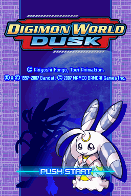
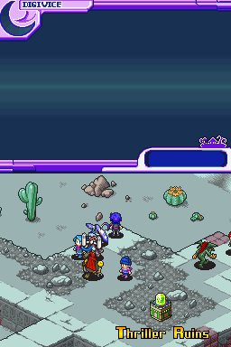

# Digimon World Dusk Recomp

**用静态重编译把《Digimon World: Dusk》(NDS 美版) 移植为原生程序。这不是模拟器。你需要自备 ROM，并在自己的电脑上构建游戏。**

[English](README.md) | 简体中文

| 标题画面 | 第一张地图（从存档载入） |
| --- | --- |
|  |  |

本项目借助 [ndsrecomp](https://github.com/mstan/ndsrecomp) 框架，把游戏的 ARM9 与 ARM7 机器码预先翻译成 C，再编译成普通的桌面程序。

> **非官方爱好者项目。** 与 Bandai Namco Entertainment、东映动画、任天堂无关，也未获其认可。本仓库不包含任何受版权保护的游戏数据。你需要自己合法取得的游戏和 DS BIOS 转储。构建产生的任何文件都包含游戏内容，请勿分享。

> **当前是早期开发者预览版，不是可游玩的发行版。** 新游戏暂时无法推进（见[状态](#状态)）。没有下载包，请从源码构建。

## 状态

在 macOS（Apple 芯片）上、原生代码启用状态下验证过：

- 启动、发行商画面、标题画面，有声音
- 主菜单、**NEW GAME**、性别选择、触摸键盘输入姓名，直到选择初始包的画面；这些画面与 melonDS 参考运行一致
- 用 melonDS 为该 ROM 写出的存档 **CONTINUE**，进入第一张地图，队伍、位置与游戏时间均正确恢复
- 在游戏内菜单存档、退出、重启后从该存档继续
- 速度：测量的游戏窗口内 576.8 fps（约 9.6 倍实时），全部解释执行时为 156.8 fps；原生代码减少了 99.6% 的解释器分派

已知问题：

- **新游戏在选择初始包之后停机。** ARM9 跳到无效地址（`0xFFFFFF70`），运行器停止。原因尚未查明。修复前只能从已有存档开始游玩。
- 零售固件启动路径会停机，因此运行器使用生成的固件镜像并直接启动卡带。
- 需要真实 BIOS 转储（`biosnds9.bin`、`biosnds7.bin`）。FreeBIOS 尚未在本游戏上测试。
- 下屏的游戏内菜单绘制位置偏低 64 像素，触摸仍能命中正确的项目。
- 18 个 ARM9 overlay 在把覆盖率提升为原生代码之前，由框架内置解释器执行。
- Windows、Linux、Android 构建尚未验证。不支持 Wi-Fi 和麦克风。

仅支持以下这一个转储，构建前会先校验：

| 项目 | 值 |
| --- | --- |
| 游戏 | Digimon World: Dusk (USA) |
| 游戏代码 | `A6RE`，revision 0 |
| 大小 | 67,108,864 字节（64 MiB） |
| SHA-1 | `de1a1915e07288ffad654f3f9f2eb730a0fd1d9c` |

## 构建

需要 git、CMake、Ninja、C/C++ 编译器、SDL3，以及安装了 `pip install -r requirements.txt` 的 Python 3.11+。然后：

```bash
export DUSK_ROM="/path/to/Digimon World - Dusk (USA).nds"
export DUSK_BIOS_DIR="/path/to/your/bios"   # 内含 biosnds9.bin 与 biosnds7.bin
tools/build_dusk.sh all
tools/build_dusk.sh run
```

完整说明（包括固定的框架版本和可选的 macOS `.app`）见 [docs/BUILDING.md](docs/BUILDING.md)，原理见 [docs/HOW_IT_WORKS.md](docs/HOW_IT_WORKS.md)。

## 许可

本仓库中的代码（构建工具、配置、文档、测试）采用 [MIT](LICENSE)。所依赖的框架主要为 **PolyForm Noncommercial 1.0.0**，另含 MIT 与 GPL-3.0 部分，因此整个移植**仅限非商业用途**。详见 [THIRD_PARTY_NOTICES.md](THIRD_PARTY_NOTICES.md)。

*Digimon* 是 Bandai Co., Ltd. 与东映动画的商标。所有游戏内容归其所有者。

## 相关项目

- [Digimon Super Xros Wars Recomp](https://github.com/aoxzh/digimon-super-xros-wars-recomp)
- [Digimon Story Sunburst Recomp](https://github.com/aoxzh/digimon-story-sunburst-recomp)
